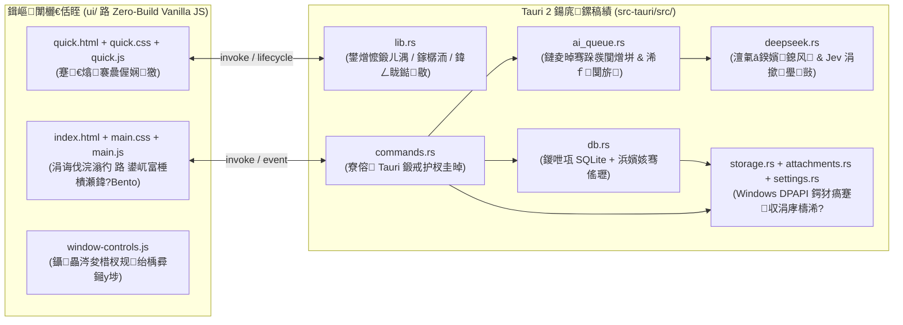

<div align="center">

# TaskVault

**闈㈠悜 Windows 妗岄潰鐨勬湰鍦颁紭鍏堛€丄I 椹卞姩鐏垫劅鏀堕泦涓庝换鍔＄鐞嗗伐浣滃彴**

[](CHANGELOG.md)
[-0ea5e9.svg)](#蹇€熷紑濮?
[](#绯荤粺鏋舵瀯)
[-10b981.svg)](#绯荤粺鏋舵瀯)
[](#鏁版嵁瀹夊叏涓庨殣绉佷繚鎶?

**绠€浣撲腑鏂?* | [English](README_EN.md) 路 [鏇存柊鏃ュ織 (Changelog)](CHANGELOG.md)

</div>

---

## 椤圭洰绠€浠?

**TaskVault** 鏄竴娆句笓涓?Windows 妗岄潰鐜鎵撻€犵殑鏈湴浼樺厛锛圠ocal-First锛変换鍔℃敹闆嗕笌鎺ㄨ繘宸ュ叿銆傚畠鑷村姏浜庤В鍐虫棩甯稿伐浣滀腑**鈥滅鐗囧寲淇℃伅璁板綍蹇€佺粨鏋勫寲鏁寸悊闅锯€?*鐨勭棝鐐癸細閫氳繃鍏ㄥ眬蹇嵎閿绉掔骇鎹曟崏涓€鍙ヨ瘽闇€姹傘€佷細璁邯瑕佹垨鑱婂ぉ鎴浘锛屽€熷姪鍏峰**涓撳瑙嗚璺敱锛圥ersona Routing锛?*鐨勫ぇ璇█妯″瀷灏嗗叾鑷姩鎷嗚В涓虹粨鏋勫寲浠诲姟鑽夌锛屾渶缁堢敱鐢ㄦ埛瀹￠槄纭鍚庤浆鍏ユ寮忎换鍔＄湅鏉裤€?

鏍稿績璁捐鍝插锛?
1. **鏋侀€熸崟鎹夛紙Instant Capture锛?*锛氬叏灞€鐑敭闅忔椂鍛煎嚭锛屼笉鎵撴柇褰撳墠缂栫爜鎴栦細璁績娴併€?
2. **涓撳绾?AI 鎷嗚В锛圝ev-Style Persona Routing锛?*锛氬唴鍖?System-1 鍓嶇疆鍐崇瓥妲斤紝鑷姩璇嗗埆鈥滅爺鍙戞帓闅?/ 浜у搧椤圭洰 / GTD 琛屽姩鈥濊澧冨苟璋冪敤瀵瑰簲涓撳鍑嗗垯鎷嗚В瀛愪换鍔°€?
3. **浜烘満鍗忓悓纭锛圚uman-in-the-Loop锛?*锛氬師濮嬭褰曟案涔呭彧璇诲瓨璇侊紝AI 浠呮彁渚涚粨鏋勫寲鑽夌寤鸿锛岃浆姝ｅ叆搴撳畬鍏ㄧ敱鐢ㄦ埛鎺屾帶銆?
4. **鏈湴鍔犲瘑瀹堟姢锛圖PAPI Encrypted锛?*锛氭暟鎹簱蹇収銆佹埅鍥鹃檮浠朵笌 API 瀵嗛挜鍧囬€氳繃 Windows DPAPI 缁戝畾褰撳墠绯荤粺璐︽埛鍔犲瘑瀛樺偍銆?

---

## 鐣岄潰棰勮

### 鏍稿績宸ヤ綔娴佷笌娴佷綋鍔ㄦ晥婕旂ず


### 鈿?`Ctrl+Alt+Q` 娴佸厜蹇€熻褰曟偓娴獥
鏀寔鏂囨湰閫熻銆佸壀璐存澘绮樿创鎴浘锛坄Ctrl+V`锛変笌鎷栨嫿鍥剧墖锛屽簳鏍忓彲鎸夐渶鍗曟潯鎸囧畾 AI 鎷嗚В涓撳韬唤锛?

![蹇€熻褰曟偓娴獥涓庝笓瀹惰瑙掕彍鍗昡(docs/screenshots/quick-capture.png)

---

## 鏍稿績鐗规€?

### 1. 鍏ㄥ眬闂康涓庡妯℃€佹埅鍥炬敹闆?
- **鍏ㄥ眬鐑敭鍛煎嚭**锛氶粯璁?`Ctrl+Alt+Q` 鍛煎嚭/闅愯棌蹇€熻褰曟偓娴獥锛宍Ctrl+Alt+W` 鍛煎嚭/闅愯棌涓诲伐浣滃彴銆?
- **涓€寮犲浘澶氬緟鍔炶瘑鍒?*锛氬崟寮犵兢鑱婃垨浼氳鎴浘淇濈暀涓轰竴鏉″師濮嬪瓨璇佽褰曪紝瑙嗚妯″瀷鍙粠涓彁鍙栧椤圭嫭绔嬪緟鍔烇紝鏀寔閫愰」瀹￠槄銆佺嫭绔嬬紪杈戜笌鍒嗗埆杞銆?
- **鎴柇鑷姩鎶㈡晳锛圫alvage Engine锛?*锛氶拡瀵瑰妯℃€侀暱杈撳嚭鎴栨帹鐞嗘ā鍨嬫€濈淮閾捐秴闄愬鑷寸殑 JSON 鎴柇锛屽唴缃娉曟爲鍓嶇紑鎶㈡晳鏈哄埗锛岃嚜鍔ㄦ仮澶嶅凡鐢熸垚鐨勫畬鏁村緟鍔炲苟鏍囪涓衡€滅粨鏋滃緟鏍稿鈥濄€?

### 2. Jev 椋庢牸鍓嶇疆鍐崇瓥妲戒笌涓撳韬唤璺敱
- **System-1 鍓嶇疆鍐崇瓥璺敱**锛氬湪榛樿 `馃 鏅鸿兘鑷€傚簲` 妯″紡涓嬶紝妯″瀷鍦ㄥ崟娆″搷搴旂殑棣栦釜 JSON 瀛楁鍏堝畬鎴愰鍩熷垎绫诲喅绛栵紙`dev` / `pm` / `gtd`锛夛紝鍊熷姪鑷洖褰掓敞鎰忓姏鏈哄埗鍦ㄥ悓涓€娆＄敓鎴愪腑鑷姩婵€娲诲搴旈鍩熺殑鎷嗚В瑙勮寖锛?
  - **`馃捇 鐮斿彂涓庢灦鏋勪笓瀹?(dev)`**锛氭寜鈥滃鐜颁笌鏃ュ織瀹氫綅 鈫?鏍瑰洜淇/鎺ュ彛瀹炵幇 鈫?鑱旇皟涓庡洖褰掕嚜娴?鈫?涓婄嚎楠岃瘉鈥濇媶瑙ｅ瓙浠诲姟锛屽苟杩介棶澶嶇幇鐜銆佹姤閿欐椂闂存鎴?TraceID銆?
  - **`馃搵 浜у搧涓庨」鐩笓瀹?(pm)`**锛氭寜鈥滈渶姹傝竟鐣岀‘璁?鈫?鏂规涓庢帓鏈熷榻?鈫?楠屾敹鏍囧噯 (DoD) 鈫?浜や粯鍚屾鈥濇媶瑙ｅ瓙浠诲姟锛屽苟杩介棶璐熻矗浜恒€佹帓鏈熻妭鐐逛笌楠屾敹鍙ｅ緞銆?
  - **`馃幆 GTD 琛屽姩鏁欑粌 (gtd)`**锛氭秷闄も€滆窡杩涖€佸鐞嗏€濈瓑妯＄硦鍔ㄨ瘝锛屽皢鐩爣鎷嗚В涓?15鈥?0 鍒嗛挓鍐呭彲绔嬪嵆鍚姩鐨勬渶灏忕墿鐞嗚鍔紙Next Action锛夈€?
- **楂橀鏍囩搴撲笂涓嬫枃娉ㄥ叆**锛氳В鏋愭椂鑷姩鎻愬彇浠诲姟搴?Top 20 楂橀鏍囩娉ㄥ叆涓婁笅鏂囷紝寮曞妯″瀷浼樺厛澶嶇敤鏃㈡湁鏍囩鍒嗙被锛岄伩鍏嶅悓涔夎瘝纰庣墖鍖栥€?
- **鐩稿鏃堕棿鏃ュ巻閿氱偣**锛氳嚜鍔ㄦ敞鍏ユ湭鏉?10 澶╃殑 `浠婂ぉ / 鏄庡ぉ / 鍚庡ぉ / 鏈懆X / 涓嬪懆X = yyyy-MM-dd` 閫熸煡琛紝澶у箙鎻愬崌鍙ｈ鍖栨埅姝㈡椂闂存帹绠楀噯纭巼銆?

### 3. 鍏ㄧ敓鍛藉懆鏈熶换鍔＄湅鏉?
- **涓夋€佸垎缁勮鍥?*锛氭寮忎换鍔℃寜鈥滆繘琛屼腑 / 宸插畬鎴?/ 宸插綊妗ｂ€濆垎妗跺睍绀猴紝鏀寔澶氱淮鑳跺泭蹇瓫锛坄P0`銆乣P1`銆佸凡閫炬湡銆佸惈瀛愪换鍔★級涓庡叧閿瘝鍏ㄦ枃妫€绱€?
- **骞傜瓑杞浜嬪姟**锛氳褰曡浆姝ｅ皢姝ｅ紡浠诲姟銆佸瓙浠诲姟娓呭崟銆佹潵婧愬揩鐓т笌鏀朵欢绠辫浆姝ｆ爣璁扮疆浜庡悓涓€鏁版嵁搴撲簨鍔′腑鎻愪氦锛屽苟浠呭湪鍔犲瘑蹇収瀹屾垚鍘熷瓙钀界洏鍚庤繑鍥炴垚鍔熴€?
- **鐙珛瀛愪换鍔′笌杩涘害杩借釜**锛氭敮鎸佷换鍔′紭鍏堢骇锛坄P0`鈥揱P3`锛夈€侀浼?瀹為檯宸ユ椂銆佽鍒掕捣姝㈡椂闂淬€佽繘搴︾櫨鍒嗘瘮鍙婂瓙浠诲姟瀹炴椂鍕鹃€夈€?

### 4. 鏈湴浼樺厛涓?Windows DPAPI 瀹夊叏鏋舵瀯
- **鍏ㄩ噺 DPAPI 闈欐€佸姞瀵?*锛氳繍琛屾湡 SQLite 鍦ㄥ唴瀛樹腑楂橀€熷鐞嗭紝姣忔鍙樻洿閫氳繃鍘熷瓙鏇挎崲鍐欏叆缁忓綋鍓?Windows 鐧诲綍璐︽埛 DPAPI 鍔犲瘑鐨勬湰鍦板揩鐓ф枃浠讹紱鍥剧墖闄勪欢涓?API Key 鍚屾牱浠?DPAPI 瀵嗘枃瀛樺偍銆?
- **鍏ㄥ紓姝ラ潪闃诲鍛戒护杈圭晫**锛氭墍鏈夋秹鍙婃暟鎹簱閿佸畾銆佸姞瀵嗗揩鐓ц惤鐩樹笌鍥剧墖缂栬В鐮佺殑 Tauri 鍛戒护鍧囧湪寮傛闃诲姹狅紙`spawn_blocking`锛変腑鎵ц锛屼繚闅?UI 甯х巼涓庡姩鏁堟祦鐣呫€?
- **闆舵瀯寤虹函闈欐€佸墠绔?*锛氬墠绔畬鍏ㄥ熀浜庡師鐢?HTML5 / CSS3 / ES2022 鏋勫缓锛岄伒寰弗鏍兼湰鍦?CSP 绛栫暐锛堟棤澶栭儴 CDN 涓庣涓夋柟杩愯鏃朵緷璧栵級銆?

---

## 蹇嵎閿竴瑙?

| 蹇嵎閿?| 浣滅敤鍩?| 鍔熻兘璇存槑 |
| :--- | :--- | :--- |
| `Ctrl + Alt + Q` | 鍏ㄥ眬绯荤粺鐑敭 | 鍛煎嚭 / 闅愯棌蹇€熻褰曟偓娴獥锛堝彲鍦ㄨ缃腑鑷畾涔夛級 |
| `Ctrl + Alt + W` | 鍏ㄥ眬绯荤粺鐑敭 | 鍛煎嚭 / 闅愯棌涓诲伐浣滃彴绐楀彛锛堝彲鍦ㄨ缃腑鑷畾涔夛級 |
| `Enter` | 蹇€熻褰曟偓娴獥 | 淇濆瓨褰撳墠鏂囨湰/鎴浘璁板綍骞惰Е鍙?AI 瑙ｆ瀽 |
| `Shift + Enter` | 蹇€熻褰曟偓娴獥 | 鍦ㄥ揩閫熻褰曡緭鍏ユ鍐呮崲琛?|
| `Ctrl + V` | 蹇€熻褰曟偓娴獥 | 鐩存帴浠庡壀璐存澘绮樿创鎴浘浣滀负闄勪欢 |
| `Esc` | 蹇€熻褰曠獥 / 寮圭獥 | 浼樺厛鏀惰捣涓嬫媺鑿滃崟鎴栧叧闂綋鍓嶆ā鎬佹 / 闅愯棌蹇€熻褰曠獥 |

---

## 绯荤粺鏋舵瀯



### 鏍稿績妯″潡瀵艰埅

| 璺緞 | 鑱岃矗璇存槑 |
| :--- | :--- |
| [`src-tauri/src/lib.rs`](src-tauri/src/lib.rs) | 搴旂敤鍏ュ彛銆佸崟瀹炰緥閿併€佺郴缁熸墭鐩樸€佸叏灞€蹇嵎閿敞鍐屼笌宕╂簝鎭㈠鍚姩娴佺▼ |
| [`src-tauri/src/commands.rs`](src-tauri/src/commands.rs) | 闈㈠悜鍓嶇鏆撮湶鐨?23 涓?Tauri 鍛戒护杈圭晫锛堟暟鎹簱涓庣鐩?I/O 鍏ㄥ紓姝ュ寲锛?|
| [`src-tauri/src/db.rs`](src-tauri/src/db.rs) | 鍐呭瓨 SQLite 绠＄悊銆佸巻鍙叉暟鎹縼绉汇€佽姹備唬娆★紙Generation Fence锛夈€佽浆姝ｅ箓绛変簨鍔′笌楂橀鏍囩缁熻 |
| [`src-tauri/src/ai_queue.rs`](src-tauri/src/ai_queue.rs) | 鏈夌晫骞跺彂锛堜笂闄?2锛堿I 鎵ц鍣ㄣ€佹寚鏁伴€€閬块噸璇曘€佷笂涓嬫枃娉ㄥ叆涓庝腑鏂换鍔℃仮澶?|
| [`src-tauri/src/deepseek.rs`](src-tauri/src/deepseek.rs) | OpenAI / Anthropic 鍙屽崗璁€傞厤銆丣ev 椋庢牸涓撳韬唤璺敱鎻愮ず璇嶃€佺浉瀵规棩鍘嗛敋鐐逛笌鎴柇 JSON 鎶㈡晳 |
| [`src-tauri/src/storage.rs`](src-tauri/src/storage.rs) | Windows `CryptProtectData` / `CryptUnprotectData` (DPAPI) 灏佽涓庡師瀛愭枃浠舵浛鎹?|
| [`src-tauri/src/attachments.rs`](src-tauri/src/attachments.rs) | 鍥剧墖榄旀暟鏍￠獙锛圥NG / JPEG / GIF / WebP锛屼笂闄?4 MiB锛夈€丏PAPI 鍔犲瘑瀛樺偍涓庤矾寰勫畨鍏ㄩ槻鎶?|
| [`src-tauri/src/settings.rs`](src-tauri/src/settings.rs) | 鏈嶅姟鍟嗛厤缃牎楠屻€丄PI Key 瀵嗘枃淇濇姢銆佽劚鏁忚鍥惧鍑轰笌瀹夊叏婧愮粦瀹?|
| [`ui/`](ui) | 鏃ュ厜/鏆楀鍙屼富棰樻瀬鍏?Bento 宸ヤ綔鍙般€丄pple Fluid Motion 娴佷綋杩囨浮涓庡揩閫熷綍鍏ョ晫闈?|

---

## 蹇€熷紑濮?

### 1. 鐩存帴涓嬭浇杩愯锛堟櫘閫氱敤鎴锋帹鑽愶級

鏃犻渶閰嶇疆浠讳綍缂栬瘧鐜锛岃鐩存帴鍓嶅線 **[GitHub Releases](https://github.com/callme707/task_vault/releases/latest)** 涓嬭浇鏈€鏂版寮忕増锛?

| 鍙戣璧勪骇鏂囦欢 | 閫傜敤鍦烘櫙 |
| :--- | :--- |
| **`TaskVault_1.2.5_x64-setup.exe`** | **鎺ㄨ崘**锛氭爣鍑?Windows NSIS 瀹夎绋嬪簭锛堟敮鎸佹闈㈠揩鎹锋柟寮忎笌鍗歌浇鍚戝锛?|
| **`TaskVault_1.2.5_x64_en-US.msi`** | 浼佷笟绾?Windows Installer (MSI) 瀹夎鍖?|
| **`TaskVault_1.2.5_x64-portable.exe`** | 鍏嶅畨瑁呭崟鏂囦欢渚挎惡鐗堬紙涓嬭浇鍚庣洿鎺ュ弻鍑诲嵆鍙繍琛岋級 |

---

### 2. 婧愮爜鏋勫缓涓庝竴閿幆澧冮厤缃紙寮€鍙戣€咃級

浠撳簱鏍圭洰褰曞凡鎻愪緵鏍囧噯鐜澹版槑鏂囦欢涓庝竴閿幆澧冮厤缃剼鏈細
- [`rust-toolchain.toml`](rust-toolchain.toml)锛氬０鏄?Rust `stable-x86_64-pc-windows-msvc` 宸ュ叿閾惧強 `clippy`銆乣rustfmt` 缁勪欢渚濊禆銆?
- [`package.json`](package.json)锛氬０鏄?Node.js锛坄>= 18.0.0`锛夎繍琛岃姹備笌甯哥敤宸ョ▼鑴氭湰锛坄npm run setup`銆乣npm run doctor`銆乣npm test` 绛夛級銆?
- [`src-tauri/Cargo.toml`](src-tauri/Cargo.toml) & [`src-tauri/Cargo.lock`](src-tauri/Cargo.lock)锛氶攣瀹氱殑 Rust 鍚庣渚濊禆娓呭崟銆?

#### 涓€閿幆澧冩娴嬩笌鑷姩瀹夎

鍙屽嚮杩愯鏍圭洰褰曠殑 [`setup-env.bat`](setup-env.bat)锛屾垨鍦?PowerShell 涓墽琛屼互涓嬪懡浠わ紝鑴氭湰灏嗚嚜鍔ㄦ娴?**WebView2 Runtime銆丮SVC C++ Build Tools銆丷ust 宸ュ叿閾俱€乀auri CLI 涓?Node.js**锛屽苟鍙€氳繃 `winget` / `rustup` / `cargo` 鑷姩琛ラ綈缂哄け缁勪欢锛?

```powershell
# 浜や簰寮忎竴閿娴嬪苟鑷姩瀹夎缂哄け鐜锛堟垨鐩存帴鍙屽嚮 setup-env.bat锛?
.\setup-env.bat

# 浠呮墽琛岀幆澧冨仴搴锋鏌ワ紙杈撳嚭缁勪欢鐗堟湰鐘舵€佽〃锛屼笉鎵ц瀹夎锛?
powershell -ExecutionPolicy Bypass -File .\scripts\setup-env.ps1 -CheckOnly

# 鏃犱汉鍊煎畧鍏ㄨ嚜鍔ㄥ畨瑁呮墍鏈夌己澶变緷璧?
powershell -ExecutionPolicy Bypass -File .\scripts\setup-env.ps1 -Yes
```

#### 寮€鍙戜笌鏋勫缓鍛戒护

```powershell
# 1. 杩涘叆 Tauri 鍚庣鐩綍骞跺惎鍔ㄥ紑鍙戞ā寮?
cd src-tauri
cargo run

# 2. 杩愯鍚庣鍗曞厓娴嬭瘯涓庝弗鏍?Clippy 闈欐€佹鏌?
cargo test --offline --locked
cargo clippy --offline --locked --all-targets -- -D warnings

# 3. 缂栬瘧浼樺寲鐗?Release 鍙墽琛屾枃浠?
cargo build --release --offline --locked

# 4. 鎵撳寘 Windows 鏈湴瀹夎绋嬪簭锛圢SIS 涓?MSI锛?
cargo tauri build --ci --bundles nsis,msi -- --offline --locked
```

鏋勫缓瀹屾垚鍚庯紝浜х墿浣嶄簬锛?
- **鐙珛鍙墽琛屾枃浠?*锛歚src-tauri/target/release/task-vault.exe`
- **NSIS 瀹夎鍖?*锛歚src-tauri/target/release/bundle/nsis/TaskVault_1.2.5_x64-setup.exe`
- **MSI 瀹夎鍖?*锛歚src-tauri/target/release/bundle/msi/TaskVault_1.2.5_x64_en-US.msi`

> [!NOTE]
> 閲嶆柊瑕嗙洊鏋勫缓 Release 浜х墿鍓嶏紝璇峰厛浠庣郴缁熸墭鐩樿彍鍗曢€€鍑烘鍦ㄨ繍琛岀殑 `TaskVault` 瀹炰緥銆?

### 鍓嶇鍥炲綊娴嬭瘯涓庣嫭绔嬮瑙?

椤圭洰鎻愪緵闆跺閮ㄦ潈闄愮殑绾墠绔悎鎴愭暟鎹瑙堟湇鍔★紙涓嶈鍐欐湰鍦扮湡瀹炴暟鎹簱鎴栧瘑閽ワ級锛?

```powershell
# 鍚姩鏈湴娌欑洅棰勮鏈嶅姟鍣?
node scripts/preview.cjs

# 杩愯鍓嶇璇硶妫€鏌ヤ笌鍥炲綊鍗曞厓娴嬭瘯
node --check ui/main.js
node --check ui/quick.js
node ui/tests/time-format.test.js
node ui/tests/task-views.test.js
```

---

## AI 鏈嶅姟閰嶇疆

TaskVault 鏀寔涓ょ被涓绘祦澶фā鍨嬫帴鍙ｅ崗璁紝鍙湪搴旂敤鍐呫€?*AI 涓庡亸濂借缃?*銆嶄腑涓€閿垏鎹㈤璁撅細

1. **OpenAI Chat Completions 鍏煎鍗忚**锛坄openai`锛夛細
   - 鏀寔 DeepSeek銆丱penAI銆並imi (Moonshot)銆侀€氫箟鍗冮棶 (Qwen)銆佹櫤璋辨竻瑷€ (GLM) 浠ュ強鏈湴 Ollama锛坄http://localhost:11434/v1`锛夌瓑鏈嶅姟绔偣銆?
2. **Anthropic Messages 瀹樻柟鍗忚**锛坄anthropic`锛夛細
   - 鏀寔 Claude 绯诲垪妯″瀷锛堝 `claude-sonnet-4-5`锛夈€?

**瀹夊叏绛栫暐璇存槑**锛?
- 杩滅▼鏈嶅姟鍦板潃寮哄埗瑕佹眰 `HTTPS`锛沗HTTP` 浠呭厑璁告湰鏈哄洖鐜湴鍧€锛坄localhost` / `127.0.0.1` / `[::1]`锛夛紝涓斿鎴风绂佹鑷姩璺熼殢 HTTP 閲嶅畾鍚戜互闃插嚟璇佹硠闇层€?
- 涓绘ā鍨嬶紙鏂囨湰鎻愮偧锛変笌瑙嗚妯″瀷锛堝浘鐗囪瘑鍒級鍙垎鍒寚瀹氾紱鑻ユ湭鍗曠嫭鎸囧畾瑙嗚妯″瀷锛屽浘鐗囪褰曞皢榛樿璋冪敤涓绘ā鍨嬨€?
- 鐜鍙橀噺 `DEEPSEEK_API_KEY`銆乣OPENAI_API_KEY`銆乣ANTHROPIC_API_KEY` 浠呭湪鏈嶅姟鍦板潃涓ユ牸鍖归厤瀵瑰簲瀹樻柟鍩熷悕鏃惰嚜鍔ㄧ敓鏁堬紱鑷畾涔夌綉鍏抽渶鍦ㄨ缃晫闈㈡樉寮忛厤缃瘑閽ャ€?

---

## 鏁版嵁瀹夊叏涓庨殣绉佷繚鎶?

- **鏈湴鏁版嵁鐩綍**锛歚%APPDATA%\com.local.taskvault\`
- **璐︽埛缁戝畾璇存槑**锛氭暟鎹簱蹇収銆佸姞瀵嗗浘鐗囬檮浠朵笌 `settings.json` 涓殑瀵嗛挜瀵嗘枃鍧囦緷璧栧綋鍓?Windows 鐢ㄦ埛鐨?DPAPI 涓诲瘑閽ャ€傝鍕垮皢鍔犲瘑鏂囦欢鐩存帴璺?Windows 璐︽埛杩佺Щ鍚庡垹闄ゅ師璐︽埛鐜銆?
- **鐗堟湰鍗囩骇寤鸿**锛氬崌绾ф柊鐗堟湰鍓嶏紝寤鸿鍏堜粠鎵樼洏鑿滃崟瀹屾暣閫€鍑烘棫鐗堝疄渚嬶紝骞跺浠?`%APPDATA%\com.local.taskvault\` 鐩綍銆?

---

## 鑷磋阿涓庤鍙?

- 鐣岄潰闈欐€佸浘鏍囧熀浜?[Lucide Icons](https://lucide.dev/)锛坄v0.468.0`锛夛紝閬靛惊 ISC 璁稿彲璇侊紙璇﹁ [`ui/icons/LICENSE`](ui/icons/LICENSE) 涓?[`ui/icons/README.md`](ui/icons/README.md)锛夈€?
- 鏃╂湡浠诲姟鍒楄〃鍒嗙粍淇℃伅灞傛璁捐鏇惧弬鑰?[Planify](https://github.com/alainm23/planify) 涓?[AppFlowy](https://github.com/AppFlowy-IO/AppFlowy) 鐨勫叕寮€鐣岄潰甯冨眬鐞嗗康銆?
