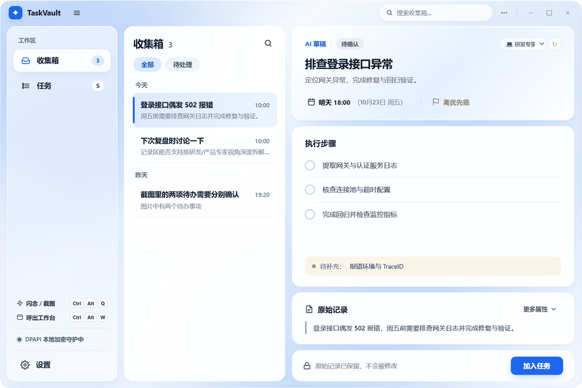
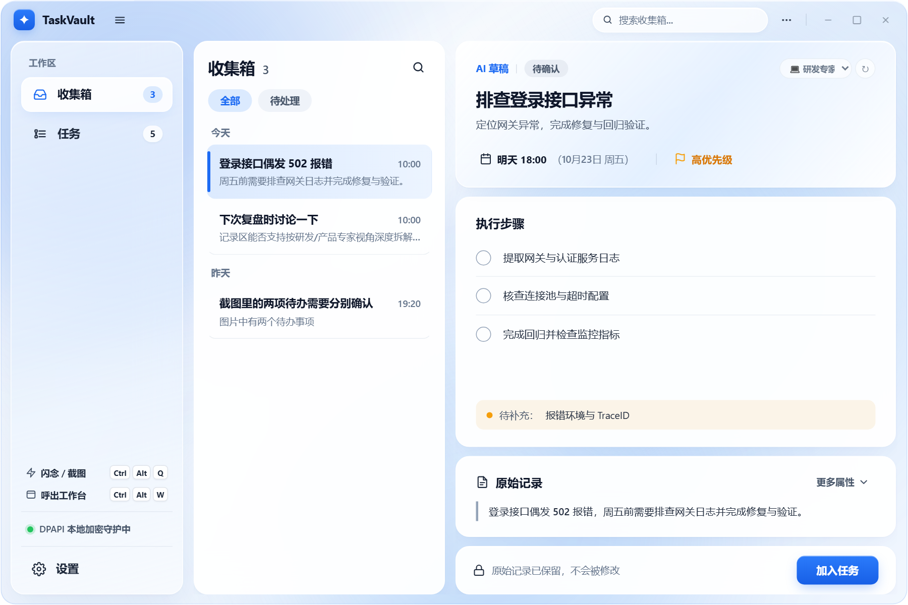
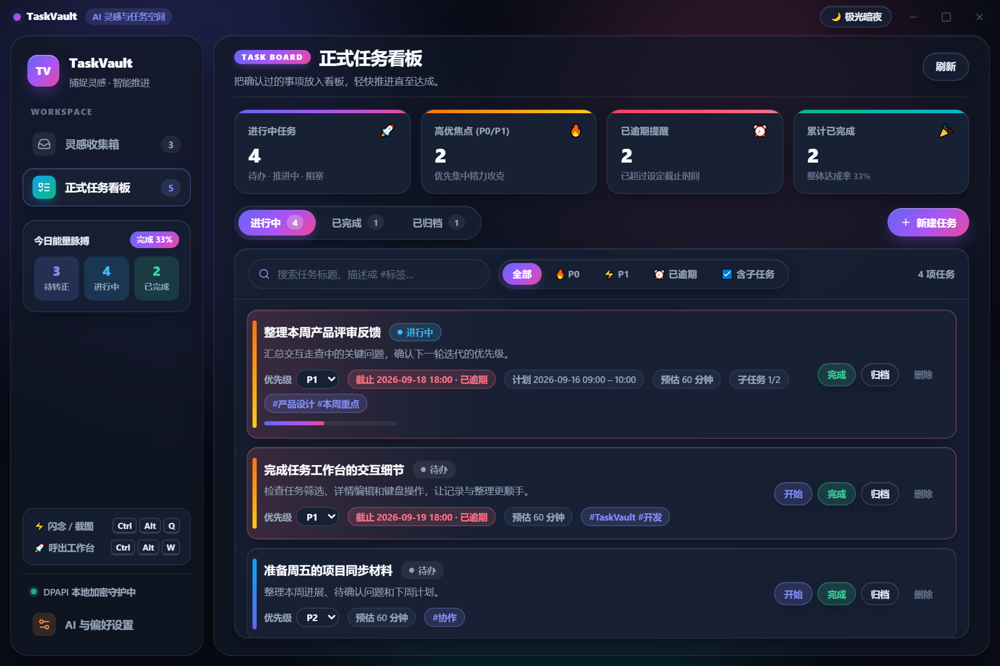
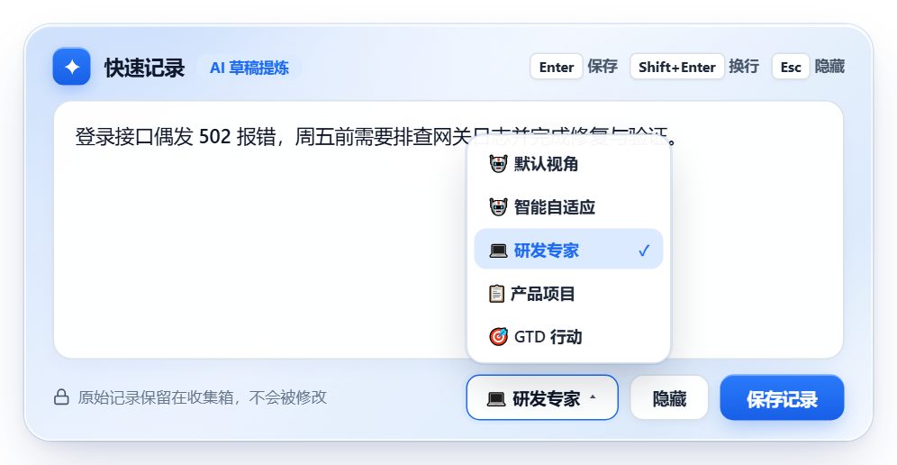
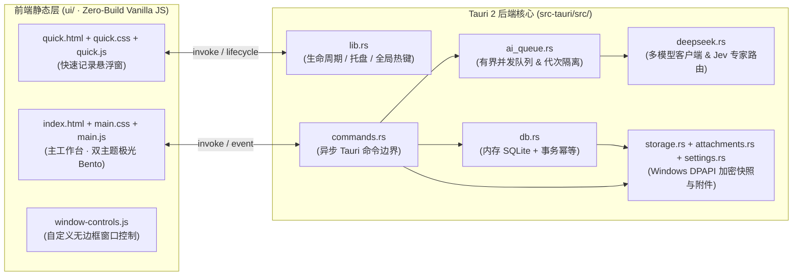

<div align="center">

# TaskVault

**面向 Windows 桌面的本地优先、AI 驱动灵感收集与任务管理工作台**

[](CHANGELOG.md)
[-0ea5e9.svg)](#快速开始)
[](#系统架构)
[-10b981.svg)](#系统架构)
[](#数据安全与隐私保护)

**简体中文** | [English](README_EN.md) · [更新日志 (Changelog)](CHANGELOG.md)

</div>

---

## 项目简介

**TaskVault** 是一款专为 Windows 桌面环境打造的本地优先（Local-First）任务收集与推进工具。它致力于解决日常工作中**“碎片化信息记录快、结构化整理难”**的痛点：通过全局快捷键毫秒级捕捉一句话需求、会议纪要或聊天截图，借助具备**专家视角路由（Persona Routing）**的大语言模型将其自动拆解为结构化任务草稿，最终由用户审阅确认后转入正式任务看板。

核心设计哲学：
1. **极速捕捉（Instant Capture）**：全局热键随时呼出，不打断当前编码或会议心流。
2. **专家级 AI 拆解（Jev-Style Persona Routing）**：内化 System-1 前置决策槽，自动识别“研发排障 / 产品项目 / GTD 行动”语境并调用对应专家准则拆解子任务。
3. **人机协同确认（Human-in-the-Loop）**：原始记录永久只读存证，AI 仅提供结构化草稿建议，转正入库完全由用户掌控。
4. **本地加密守护（DPAPI Encrypted）**：数据库快照、截图附件与 API 密钥均通过 Windows DPAPI 绑定当前系统账户加密存储。

---

## 界面预览

### 核心工作流与流体动效演示



### ☀️ 活力日光 · 灵感收集箱与 AI 审阅台
点选左侧收集流中的记录，右侧审阅台按弹簧物理曲线级联展开原始存证、AI 决策视角徽章与任务草稿编辑器：



### 🌙 极光暗夜 · 正式任务 Bento 看板
配备四维实时脉冲指标卡（进行中、高优焦点、已逾期、累计完成）与多维胶囊快筛，清晰管理任务全生命周期：



### ⚡ `Ctrl+Alt+Q` 流光快速记录悬浮窗
支持文本速记、剪贴板粘贴截图（`Ctrl+V`）与拖拽图片，底栏可按需单条指定 AI 拆解专家身份：



---

## 核心特性

### 1. 全局闪念与多模态截图收集
- **全局热键呼出**：默认 `Ctrl+Alt+Q` 呼出/隐藏快速记录悬浮窗，`Ctrl+Alt+W` 呼出/隐藏主工作台。
- **一张图多待办识别**：单张群聊或会议截图保留为一条原始存证记录，视觉模型可从中提取多项独立待办，支持逐项审阅、独立编辑与分别转正。
- **截断自动抢救（Salvage Engine）**：针对多模态长输出或推理模型思维链超限导致的 JSON 截断，内置语法树前缀抢救机制，自动恢复已生成的完整待办并标记为“结果待核对”。

### 2. Jev 风格前置决策槽与专家身份路由
- **System-1 前置决策路由**：在默认 `🤖 智能自适应` 模式下，模型在单次响应的首个 JSON 字段先完成领域分类决策（`dev` / `pm` / `gtd`），借助自回归注意力机制在同一次生成中自动激活对应领域的拆解规范：
  - **`💻 研发与架构专家 (dev)`**：按“复现与日志定位 → 根因修复/接口实现 → 联调与回归自测 → 上线验证”拆解子任务，并追问复现环境、报错时间段或 TraceID。
  - **`📋 产品与项目专家 (pm)`**：按“需求边界确认 → 方案与排期对齐 → 验收标准 (DoD) → 交付同步”拆解子任务，并追问负责人、排期节点与验收口径。
  - **`🎯 GTD 行动教练 (gtd)`**：消除“跟进、处理”等模糊动词，将目标拆解为 15–30 分钟内可立即启动的最小物理行动（Next Action）。
- **高频标签库上下文注入**：解析时自动提取任务库 Top 20 高频标签注入上下文，引导模型优先复用既有标签分类，避免同义词碎片化。
- **相对时间日历锚点**：自动注入未来 10 天的 `今天 / 明天 / 后天 / 本周X / 下周X = yyyy-MM-dd` 速查表，大幅提升口语化截止时间推算准确率。

### 3. 全生命周期任务看板
- **三态分组视图**：正式任务按“进行中 / 已完成 / 已归档”分桶展示，支持多维胶囊快筛（`P0`、`P1`、已逾期、含子任务）与关键词全文检索。
- **幂等转正事务**：记录转正将正式任务、子任务清单、来源快照与收件箱转正标记置于同一数据库事务中提交，并仅在加密快照完成原子落盘后返回成功。
- **独立子任务与进度追踪**：支持任务优先级（`P0`–`P3`）、预估/实际工时、计划起止时间、进度百分比及子任务实时勾选。

### 4. 本地优先与 Windows DPAPI 安全架构
- **全量 DPAPI 静态加密**：运行期 SQLite 在内存中高速处理，每次变更通过原子替换写入经当前 Windows 登录账户 DPAPI 加密的本地快照文件；图片附件与 API Key 同样以 DPAPI 密文存储。
- **全异步非阻塞命令边界**：所有涉及数据库锁定、加密快照落盘与图片编解码的 Tauri 命令均在异步阻塞池（`spawn_blocking`）中执行，保障 UI 帧率与动效流畅。
- **零构建纯静态前端**：前端完全基于原生 HTML5 / CSS3 / ES2022 构建，遵循严格本地 CSP 策略（无外部 CDN 与第三方运行时依赖）。

---

## 快捷键一览

| 快捷键 | 作用域 | 功能说明 |
| :--- | :--- | :--- |
| `Ctrl + Alt + Q` | 全局系统热键 | 呼出 / 隐藏快速记录悬浮窗（可在设置中自定义） |
| `Ctrl + Alt + W` | 全局系统热键 | 呼出 / 隐藏主工作台窗口（可在设置中自定义） |
| `Enter` | 快速记录悬浮窗 | 保存当前文本/截图记录并触发 AI 解析 |
| `Shift + Enter` | 快速记录悬浮窗 | 在快速记录输入框内换行 |
| `Ctrl + V` | 快速记录悬浮窗 | 直接从剪贴板粘贴截图作为附件 |
| `Esc` | 快速记录窗 / 弹窗 | 优先收起下拉菜单或关闭当前模态框 / 隐藏快速记录窗 |

---

## 系统架构



### 核心模块导航

| 路径 | 职责说明 |
| :--- | :--- |
| [`src-tauri/src/lib.rs`](src-tauri/src/lib.rs) | 应用入口、单实例锁、系统托盘、全局快捷键注册与崩溃恢复启动流程 |
| [`src-tauri/src/commands.rs`](src-tauri/src/commands.rs) | 面向前端暴露的 23 个 Tauri 命令边界（数据库与磁盘 I/O 全异步化） |
| [`src-tauri/src/db.rs`](src-tauri/src/db.rs) | 内存 SQLite 管理、历史数据迁移、请求代次（Generation Fence）、转正幂等事务与高频标签统计 |
| [`src-tauri/src/ai_queue.rs`](src-tauri/src/ai_queue.rs) | 有界并发（上限 2）AI 执行器、指数退避重试、上下文注入与中断任务恢复 |
| [`src-tauri/src/deepseek.rs`](src-tauri/src/deepseek.rs) | OpenAI / Anthropic 双协议适配、Jev 风格专家身份路由提示词、相对日历锚点与截断 JSON 抢救 |
| [`src-tauri/src/storage.rs`](src-tauri/src/storage.rs) | Windows `CryptProtectData` / `CryptUnprotectData` (DPAPI) 封装与原子文件替换 |
| [`src-tauri/src/attachments.rs`](src-tauri/src/attachments.rs) | 图片魔数校验（PNG / JPEG / GIF / WebP，上限 4 MiB）、DPAPI 加密存储与路径安全防护 |
| [`src-tauri/src/settings.rs`](src-tauri/src/settings.rs) | 服务商配置校验、API Key 密文保护、脱敏视图导出与安全源绑定 |
| [`ui/`](ui) | 日光/暗夜双主题极光 Bento 工作台、Apple Fluid Motion 流体过渡与快速录入界面 |

---

## 快速开始

### 环境要求
- **操作系统**：Windows 10 / 11 (x64)，内置 Microsoft Edge WebView2 运行时
- **Rust 工具链**：`rustc >= 1.77.2`（建议使用最新 stable 工具链）
- **Node.js**（可选）：用于运行前端回归单元测试与独立沙盒预览服务器

### 开发与构建命令

```powershell
# 1. 进入 Tauri 后端目录并启动开发模式
cd src-tauri
cargo run

# 2. 运行后端单元测试与严格 Clippy 静态检查
cargo test --offline --locked
cargo clippy --offline --locked --all-targets -- -D warnings

# 3. 编译优化版 Release 可执行文件
cargo build --release --offline --locked

# 4. 打包 Windows 本地安装程序（NSIS 与 MSI）
cargo tauri build --ci --bundles nsis,msi -- --offline --locked
```

构建完成后，产物位于：
- **独立可执行文件**：`src-tauri/target/release/task-vault.exe`
- **NSIS 安装包**：`src-tauri/target/release/bundle/nsis/TaskVault_1.1.0_x64-setup.exe`
- **MSI 安装包**：`src-tauri/target/release/bundle/msi/TaskVault_1.1.0_x64_en-US.msi`

> [!NOTE]
> 重新覆盖构建 Release 产物前，请先从系统托盘菜单退出正在运行的 `TaskVault` 实例。

### 前端回归测试与独立预览

项目提供零外部权限的纯前端合成数据预览服务（不读写本地真实数据库或密钥）：

```powershell
# 启动本地沙盒预览服务器
node scripts/preview.cjs

# 运行前端语法检查与回归单元测试
node --check ui/main.js
node --check ui/quick.js
node ui/tests/time-format.test.js
node ui/tests/task-views.test.js
```

---

## AI 服务配置

TaskVault 支持两类主流大模型接口协议，可在应用内「**AI 与偏好设置**」中一键切换预设：

1. **OpenAI Chat Completions 兼容协议**（`openai`）：
   - 支持 DeepSeek、OpenAI、Kimi (Moonshot)、通义千问 (Qwen)、智谱清言 (GLM) 以及本地 Ollama（`http://localhost:11434/v1`）等服务端点。
2. **Anthropic Messages 官方协议**（`anthropic`）：
   - 支持 Claude 系列模型（如 `claude-sonnet-4-5`）。

**安全策略说明**：
- 远程服务地址强制要求 `HTTPS`；`HTTP` 仅允许本机回环地址（`localhost` / `127.0.0.1` / `[::1]`），且客户端禁止自动跟随 HTTP 重定向以防凭证泄露。
- 主模型（文本提炼）与视觉模型（图片识别）可分别指定；若未单独指定视觉模型，图片记录将默认调用主模型。
- 环境变量 `DEEPSEEK_API_KEY`、`OPENAI_API_KEY`、`ANTHROPIC_API_KEY` 仅在服务地址严格匹配对应官方域名时自动生效；自定义网关需在设置界面显式配置密钥。

---

## 数据安全与隐私保护

- **本地数据目录**：`%APPDATA%\com.local.taskvault\`
- **账户绑定说明**：数据库快照、加密图片附件与 `settings.json` 中的密钥密文均依赖当前 Windows 用户的 DPAPI 主密钥。请勿将加密文件直接跨 Windows 账户迁移后删除原账户环境。
- **版本升级建议**：升级新版本前，建议先从托盘菜单完整退出旧版实例，并备份 `%APPDATA%\com.local.taskvault\` 目录。

---

## 致谢与许可

- 界面静态图标基于 [Lucide Icons](https://lucide.dev/)（`v0.468.0`），遵循 ISC 许可证（详见 [`ui/icons/LICENSE`](ui/icons/LICENSE) 与 [`ui/icons/README.md`](ui/icons/README.md)）。
- 早期任务列表分组信息层次设计曾参考 [Planify](https://github.com/alainm23/planify) 与 [AppFlowy](https://github.com/AppFlowy-IO/AppFlowy) 的公开界面布局理念。
