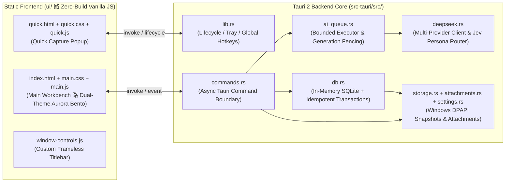

<div align="center">

# TaskVault

**A Local-First, AI-Powered Desktop Inbox & Task Management Workbench for Windows**

[](CHANGELOG.md)
[-0ea5e9.svg)](#getting-started)
[](#architecture)
[-10b981.svg)](#architecture)
[](#data-security--privacy)

[绠€浣撲腑鏂嘳(README.md) | **English** 路 [Changelog](CHANGELOG.md)

</div>

---

## Overview

**TaskVault** is a local-first desktop productivity workbench designed for Windows. It bridges the gap between **frictionless thought capture** and **structured task execution**: press a global hotkey anytime to jot down a raw note or paste a screenshot, let AI automatically triage and decompose it through specialized **Expert Personas**, and promote verified drafts into your formal task board with a single click.

Core Design Principles:
1. **Instant Capture**: Global hotkeys (`Ctrl+Alt+Q`) let you capture ideas or screenshots in milliseconds without breaking your flow.
2. **Jev-Style Expert Persona Routing**: Incorporates a System-1 typed pre-decision slot that routes incoming notes to specialized Engineering (`dev`), Product/Project (`pm`), or GTD Action (`gtd`) decomposition rubrics within a single LLM pass.
3. **Human-in-the-Loop Control**: Raw inbox entries remain immutable as a permanent audit trail; AI generates editable drafts, and only you decide what enters the formal task board.
4. **Local-First & DPAPI Encrypted**: Database snapshots, image attachments, and API credentials are encrypted at rest using Windows Data Protection API (DPAPI) bound to your OS user account.

---

## Visual Showcase

### Interactive Workflow & Fluid Motion Demo


### 鈽€锔?Sunlit Aurora (Light Mode) 路 Inbox Studio & AI Inspector
Select any captured entry on the left to trigger a spring-physics cascading inspection view with expert routing badges, confidence scores, and an interactive draft editor:


### 馃寵 Electric Aurora (Dark Mode) 路 Formal Task Bento Board
Track active, high-priority (`P0`/`P1`), overdue, and completed tasks at a glance with real-time Bento metric cards and multi-dimensional capsule filters:


### 鈿?`Ctrl+Alt+Q` Quick Capture Popup
A frameless, neon-accented spotlight popup supporting instant text input, clipboard screenshot paste (`Ctrl+V`), drag-and-drop images, and per-item expert persona selection:


---

## Key Features

### 1. Frictionless Text & Multimodal Screenshot Capture
- **Global System Shortcuts**: Toggle the Quick Capture popup via `Ctrl+Alt+Q` or summon the main workbench via `Ctrl+Alt+W` from any application.
- **Multi-Item Vision Extraction**: A single chat or meeting screenshot is preserved as one immutable inbox record while the vision model extracts multiple distinct action items鈥攅ach individually reviewable and promotable.
- **Truncated JSON Salvage Engine**: Automatically recovers valid completed items from partially truncated LLM/VLM outputs and flags them as `partial` ("Needs Review") instead of discarding the entire response.

### 2. Jev-Style Pre-Decision Slot & Expert Persona Routing
- **System-1 In-Prompt Routing**: In the default `馃 Auto-Adaptive` mode, the model outputs a typed `"persona"` decision in the very first JSON field (`"dev"` | `"pm"` | `"gtd"`), leveraging autoregressive attention to lock into the corresponding expert decomposition rubric:
  - **`馃捇 Engineering & Architecture (dev)`**: Breaks tasks into *Reproduction & Log Triage 鈫?Root-Cause Fix / API Implementation 鈫?Integration Testing 鈫?Rollout & Verification*, while flagging missing environment or TraceID details.
  - **`馃搵 Product & Project Management (pm)`**: Breaks tasks into *Scope Alignment 鈫?Solution & Schedule Review 鈫?Definition of Done (DoD) 鈫?Stakeholder Sync*, while flagging missing owners or deadlines.
  - **`馃幆 GTD Action Coach (gtd)`**: Eliminates vague verbs ("follow up", "look into") and decomposes goals into concrete 15鈥?0 minute physical Next Actions.
- **Tag Taxonomy Injection**: Automatically injects the top 20 most frequent tags from your existing task database into the prompt context so the AI reuses established tags rather than inventing synonyms.
- **Relative Calendar Anchoring**: Injects a 10-day relative date lookup table (`Today / Tomorrow / This Sat / Next Mon = yyyy-MM-dd`) into every request for accurate deadline resolution.

### 3. Full-Lifecycle Task Management
- **Three-Stage Buckets**: Organize formal tasks across **Active**, **Completed**, and **Archived** views with instant search and quick-filter capsules.
- **Idempotent Atomic Promotion**: Promoting an inbox item commits the formal task, subtasks, source snapshot, and promotion marker in a single atomic transaction, succeeding only after the DPAPI-encrypted snapshot is safely persisted to disk.
- **Independent Subtasks & Progress Tracking**: Manage priorities (`P0`鈥揱P3`), estimated vs. actual minutes, planned start/end times, completion percentages, and interactive subtask checklists.

### 4. Local-First Security & Non-Blocking Architecture
- **End-to-End Windows DPAPI Protection**: SQLite runs in memory for instant responsiveness and atomically writes DPAPI-encrypted snapshots to disk on every mutation. Attachments and API keys are likewise DPAPI-encrypted.
- **Async Command Boundary**: All database and attachment I/O commands execute on background worker threads (`spawn_blocking`) to keep the UI thread and animations completely stutter-free.
- **Zero-Build Static Frontend**: Pure HTML5, CSS3, and ES2022 JavaScript under a strict local Content Security Policy (`default-src 'self'`), with zero external CDN or runtime dependencies.

---

## Keyboard Shortcuts

| Shortcut | Scope | Action |
| :--- | :--- | :--- |
| `Ctrl + Alt + Q` | Global OS Hotkey | Toggle Quick Capture popup window (customizable) |
| `Ctrl + Alt + W` | Global OS Hotkey | Toggle Main Workbench window (customizable) |
| `Enter` | Quick Capture | Save current note/screenshot and enqueue AI parsing |
| `Shift + Enter` | Quick Capture | Insert a newline in the Quick Capture editor |
| `Ctrl + V` | Quick Capture | Paste an image directly from the system clipboard |
| `Esc` | Quick Capture / Modals | Close open dropdown menu, dismiss active modal, or hide Quick Capture |

---

## Architecture



### Source Code Structure

| Path | Responsibility |
| :--- | :--- |
| [`src-tauri/src/lib.rs`](src-tauri/src/lib.rs) | Application bootstrap, single-instance lock, system tray, global shortcuts, and startup recovery |
| [`src-tauri/src/commands.rs`](src-tauri/src/commands.rs) | 23 Tauri commands exposed to the UI with async `spawn_blocking` I/O boundaries |
| [`src-tauri/src/db.rs`](src-tauri/src/db.rs) | In-memory SQLite engine, legacy migration, generation fencing, idempotent promotion, and tag frequency ranking |
| [`src-tauri/src/ai_queue.rs`](src-tauri/src/ai_queue.rs) | Bounded concurrency (max 2) AI queue, retry backoff, context injection, and unfinished task recovery |
| [`src-tauri/src/deepseek.rs`](src-tauri/src/deepseek.rs) | OpenAI & Anthropic protocol clients, Jev-style persona routing prompts, calendar anchors, and JSON salvage |
| [`src-tauri/src/storage.rs`](src-tauri/src/storage.rs) | Windows `CryptProtectData` / `CryptUnprotectData` (DPAPI) wrapper and atomic file replacement |
| [`src-tauri/src/attachments.rs`](src-tauri/src/attachments.rs) | Image magic-byte validation (PNG / JPEG / GIF / WebP, max 4 MiB), encrypted storage, and path traversal protection |
| [`src-tauri/src/settings.rs`](src-tauri/src/settings.rs) | Provider configuration validation, DPAPI key protection, redacted UI views, and origin binding |
| [`ui/`](ui) | Dual-theme Sunlit/Dark Aurora Bento UI, Apple Fluid Motion transitions, and Quick Capture popup |

---

## Getting Started

### 1. Direct Download (Recommended for End Users)

No build tools required鈥攄ownload the latest pre-built Windows binaries directly from **[GitHub Releases](https://github.com/callme707/task_vault/releases/latest)**:

| Release Asset | Description |
| :--- | :--- |
| **`TaskVault_1.2.5_x64-setup.exe`** | **Recommended**: Standard Windows NSIS installer with shortcuts and uninstaller |
| **`TaskVault_1.2.5_x64_en-US.msi`** | Windows Installer (MSI) package |
| **`TaskVault_1.2.5_x64-portable.exe`** | Standalone portable executable (run directly without installation) |

---

### 2. Build from Source & One-Click Environment Setup (Developers)

The repository root includes standard environment manifests and an automated setup wizard:
- [`rust-toolchain.toml`](rust-toolchain.toml): Pins the `stable-x86_64-pc-windows-msvc` toolchain along with `clippy` and `rustfmt`.
- [`package.json`](package.json): Declares Node.js (`>= 18.0.0`) engine requirements and convenient workspace scripts (`npm run setup`, `npm run doctor`, `npm test`, etc.).
- [`src-tauri/Cargo.toml`](src-tauri/Cargo.toml) & [`src-tauri/Cargo.lock`](src-tauri/Cargo.lock): Locked Rust backend dependency graph.

#### One-Click Environment Doctor & Auto-Installer

Double-click [`setup-env.bat`](setup-env.bat) at the repository root (or run it from PowerShell) to automatically inspect **WebView2 Runtime, MSVC C++ Build Tools, Rust Toolchain, Tauri CLI, and Node.js**, and install any missing prerequisites via `winget`, `rustup`, and `cargo`:

```powershell
# Interactive check & automatic installation of missing prerequisites
.\setup-env.bat

# Diagnostics only (prints component status table without installing)
powershell -ExecutionPolicy Bypass -File .\scripts\setup-env.ps1 -CheckOnly

# Unattended installation of all missing prerequisites
powershell -ExecutionPolicy Bypass -File .\scripts\setup-env.ps1 -Yes
```

#### Build & Development Commands

```powershell
# 1. Start in development mode
cd src-tauri
cargo run

# 2. Run backend unit tests and strict Clippy lints
cargo test --offline --locked
cargo clippy --offline --locked --all-targets -- -D warnings

# 3. Build optimized Release binary
cargo build --release --offline --locked

# 4. Package Windows installers (NSIS & MSI)
cargo tauri build --ci --bundles nsis,msi -- --offline --locked
```

Build artifacts are generated at:
- **Portable Release Binary**: `src-tauri/target/release/task-vault.exe`
- **NSIS Installer**: `src-tauri/target/release/bundle/nsis/TaskVault_1.2.5_x64-setup.exe`
- **MSI Installer**: `src-tauri/target/release/bundle/msi/TaskVault_1.2.5_x64_en-US.msi`

> [!NOTE]
> Before overwriting a running Release binary, exit any active `TaskVault` instance from the system tray menu.

### Frontend Regression Tests & Standalone Preview

A sandboxed preview server is included for inspecting the UI with synthetic in-memory data (without touching local databases or credentials):

```powershell
# Launch standalone synthetic UI preview server
node scripts/preview.cjs

# Run frontend syntax checks and unit tests
node --check ui/main.js
node --check ui/quick.js
node ui/tests/time-format.test.js
node ui/tests/task-views.test.js
```

---

## AI Provider Configuration

TaskVault supports two industry-standard LLM protocols, configurable via **AI & Preferences** in the sidebar:

1. **OpenAI Chat Completions Compatible (`openai`)**:
   - Works out of the box with DeepSeek, OpenAI, Kimi (Moonshot), Qwen (DashScope), GLM (Zhipu), and local Ollama (`http://localhost:11434/v1`).
2. **Anthropic Messages API (`anthropic`)**:
   - Supports official Claude endpoints (e.g., `claude-sonnet-4-5`).

**Endpoint Security Policies**:
- Remote endpoints must use `HTTPS`; plain `HTTP` is restricted strictly to loopback addresses (`localhost`, `127.0.0.1`, `[::1]`). HTTP redirects are disabled to prevent credential leakage.
- Primary (text) and Vision (image) models can be configured separately; if the Vision model field is left blank, image records fall back to the primary model.
- Environment variables (`DEEPSEEK_API_KEY`, `OPENAI_API_KEY`, `ANTHROPIC_API_KEY`) are bound strictly to their respective official domains. Custom gateways require an explicitly saved key in Settings.

---

## Data Security & Privacy

- **Data Directory**: `%APPDATA%\com.local.taskvault\`
- **User Account Binding**: Encrypted database snapshots, image attachments, and API keys are bound to your current Windows user profile via DPAPI. Do not copy encrypted files to a different Windows user account and delete the original environment.
- **Upgrade Procedure**: Exit the running TaskVault instance from the system tray and back up `%APPDATA%\com.local.taskvault\` prior to upgrading.

---

## Acknowledgments & License

- Static UI icons are sourced from [Lucide Icons](https://lucide.dev/) (`v0.468.0`) under the ISC License (see [`ui/icons/LICENSE`](ui/icons/LICENSE) and [`ui/icons/README.md`](ui/icons/README.md)).
- Early task grouping and list hierarchy concepts were inspired by public interface designs from [Planify](https://github.com/alainm23/planify) and [AppFlowy](https://github.com/AppFlowy-IO/AppFlowy).
